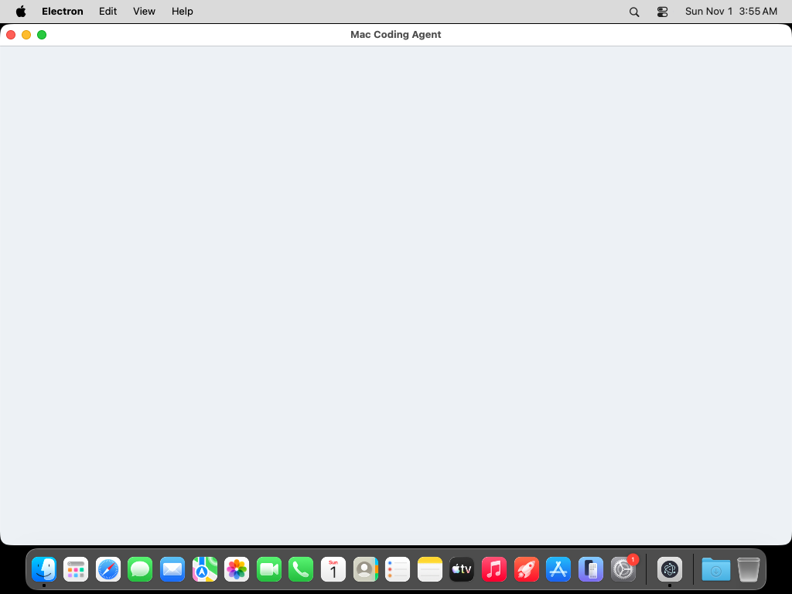

# Mac Coding Agent

**Mac Coding Agent** is a 24/7 local coding agent for macOS. It runs on your Mac Mini / Mac, talks to open-source or local models (Ollama, LM Studio, OpenAI-compatible endpoints), and ships with:

- a **macOS desktop app** (install to `/Applications`)
- a **web dashboard**
- an **iPhone companion**
- Stripe billing + backend entitlements

Verified on real macOS CI (`macos-latest`, Apple Silicon): Electron launched and `/api/health` responded. See [`docs/proof/`](docs/proof/).

---

## Install on macOS (Mac Mini)

### 1. Download

Get the latest installer zip:

- In-repo: [`web/public/downloads/MacCodingAgent-macOS-latest.zip`](web/public/downloads/MacCodingAgent-macOS-latest.zip)
- Raw (this branch):  
  https://github.com/LightLLM/MacCodingAgent/raw/cursor/mac-coding-agent-6476/web/public/downloads/MacCodingAgent-macOS-latest.zip

### 2. Unzip

Double-click the zip (or):

```bash
unzip MacCodingAgent-macOS-latest.zip
cd MacCodingAgent-macOS-latest   # or the unzipped folder
```

You should see:

| File | Purpose |
|------|---------|
| `Mac Coding Agent.app` | Desktop app |
| `Install Mac Coding Agent.command` | Installs to `/Applications` |
| `Open Without Installing.command` | Run from this folder |
| `README-INSTALL-MAC-MINI.txt` | Short install notes |

### 3. Install

1. Double-click **`Install Mac Coding Agent.command`**
2. If macOS Gatekeeper blocks it: **right-click → Open → Open**
3. The app is copied to **`/Applications/Mac Coding Agent.app`** and launches

First launch downloads the Electron runtime for your chip (~90MB, Apple Silicon or Intel). Needs internet once.

### 4. Use it

- Desktop window opens with the local agent
- Embedded API listens on localhost
- Built-in stub model works offline
- Optional: install [Ollama](https://ollama.com) for richer local models

### Requirements

- macOS **13 Ventura** or later (Sonoma / Sequoia OK)
- Apple Silicon (M1–M4) **or** Intel Mac Mini
- Internet on first launch only

### Rebuild the Mac package (developers)

```bash
npm run pack:macos
```

---

## What’s included

| Surface | Path | Description |
|---------|------|-------------|
| macOS desktop | `macos/desktop/` + download zip | Local Electron app + embedded agent |
| Agent daemon | `agent/` | Always-on Node service (models, sessions, tasks) |
| Web app | `web/` | Next.js dashboard — status, chat, models, pricing, download |
| iPhone app | `ios/MacCodingAgent/` | SwiftUI companion |
| Proof | `docs/proof/` | Package + e2e reports (incl. real Darwin CI) |

## Quick start (web + daemon)

```bash
npm install
npm run dev
```

- Web: http://localhost:3000  
- Agent API: http://localhost:8787/api/health  

```bash
# Optional local model
export MCA_MODEL_BASE_URL=http://127.0.0.1:11434
export MCA_MODEL_NAME=llama3.2
```

## Pricing (Stripe)

- Web: `/pricing` — Pro Monthly / Pro Lifetime
- Backend: `/api/billing/checkout`, `/api/billing/webhook`
- Download page: `/download`

Set `STRIPE_SECRET_KEY` and `STRIPE_PUBLISHABLE_KEY` for live charges (demo mode works without keys).

## iPhone app

Open `ios/MacCodingAgent/MacCodingAgent.xcodeproj` in Xcode, set the agent URL to your Mac (`http://<mac-lan-ip>:8787`), then run.

## Tests

```bash
npm run test:unit         # agent + web unit tests
npm run test:macos:unit   # desktop server + .app package validation
npm run test:macos:e2e    # unpack zip, health + chat; Electron on Darwin
npm run test:e2e          # Playwright web e2e
```

GitHub Actions runs **macOS desktop e2e (real macOS)** on `macos-latest` and uploads proof artifacts.

### Latest Darwin proof (CI)

```json
{
  "ok": true,
  "platform": "darwin",
  "arch": "arm64",
  "electronLaunch": true,
  "electronNote": "Electron launched on Darwin; /api/health OK"
}
```

Full files: [`docs/proof/macos-e2e-report.json`](docs/proof/macos-e2e-report.json)

## Architecture

```
┌──────────────────┐     ┌──────────────────┐     ┌─────────────────┐
│ macOS desktop    │────▶│ Local agent API  │────▶│ Ollama / stub   │
│ /Applications    │     │ localhost        │     │                 │
└──────────────────┘     └────────┬─────────┘     └─────────────────┘
┌──────────────────┐              │
│ Web / iPhone     │──────────────┘
└──────────────────┘
```

## Deploy on Vercel

```bash
npx vercel --prod
```

Or import `LightLLM/MacCodingAgent` in the Vercel dashboard (`vercel.json` at repo root).

## Screenshots

| Home | Agent | iPhone | macOS CI |
|------|-------|--------|----------|
|  |  |  |  |

## License

MIT © LightLLM
