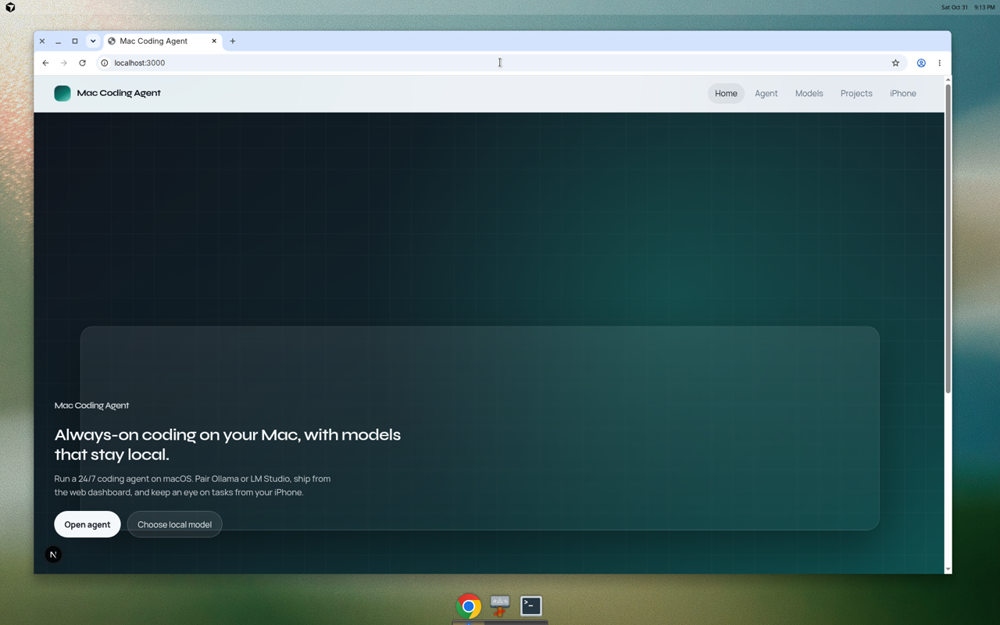
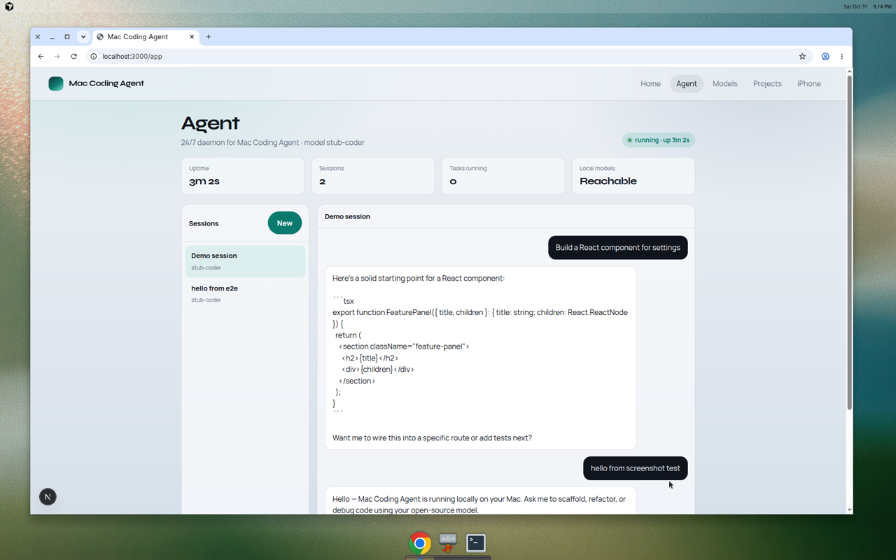
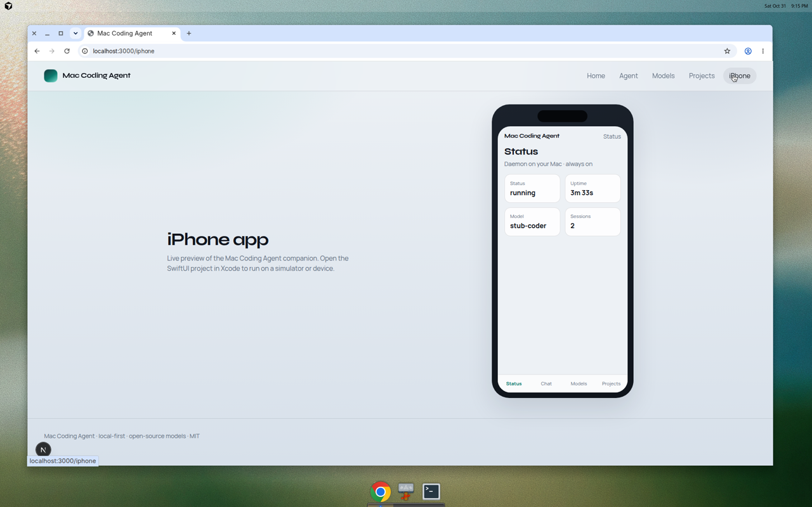

# Mac Coding Agent

**Mac Coding Agent** is a 24/7 local coding agent for macOS. It runs continuously on your Mac, talks to open-source or local models (Ollama, LM Studio, and compatible OpenAI-style endpoints), and ships with a web dashboard plus an iPhone companion app.

## What’s included

| Surface | Path | Description |
|---------|------|-------------|
| Agent daemon | `agent/` | Always-on Node service: models, sessions, coding tasks, health |
| Web app | `web/` | Next.js dashboard — status, chat, models, projects |
| iPhone app | `ios/MacCodingAgent/` | SwiftUI companion for monitoring and prompting on the go |

## Requirements

- Node.js 20+
- Optional: [Ollama](https://ollama.com) (or any OpenAI-compatible local server) for real model inference
- Xcode 15+ (for the iPhone app)

Without Ollama, the agent uses a built-in **local stub model** so the UI and APIs still work for development and demos.

## Quick start

```bash
npm install
npm run dev
```

- Web app: [http://localhost:3000](http://localhost:3000)
- Agent API: [http://localhost:8787](http://localhost:8787)
- Health: [http://localhost:8787/api/health](http://localhost:8787/api/health)

Point the agent at your local model:

```bash
# Ollama (default)
export MCA_MODEL_BASE_URL=http://127.0.0.1:11434
export MCA_MODEL_NAME=llama3.2

# Or LM Studio / OpenAI-compatible
export MCA_MODEL_BASE_URL=http://127.0.0.1:1234/v1
export MCA_MODEL_PROVIDER=openai-compatible
export MCA_MODEL_NAME=local-model
```

## iPhone app

Open `ios/MacCodingAgent/MacCodingAgent.xcodeproj` in Xcode, set your Mac’s LAN IP in Settings (default `http://<your-mac>:8787`), then run on a simulator or device. The phone talks to the same agent daemon as the web app.

## Tests

```bash
npm run test:unit    # Vitest unit tests (agent + web)
npm run test:e2e     # Playwright end-to-end (web + API)
npm test             # unit then e2e
```

## Architecture

```
┌─────────────┐     ┌──────────────────┐     ┌─────────────────┐
│  Web app    │────▶│  Agent daemon    │────▶│ Local models    │
│  :3000      │     │  :8787 (24/7)    │     │ Ollama / LM…    │
└─────────────┘     └────────┬─────────┘     └─────────────────┘
┌─────────────┐              │
│  iPhone app │──────────────┘
└─────────────┘
```

The daemon keeps an uptime clock, queues coding tasks, streams chat replies, and exposes REST + Server-Sent Events so both clients stay in sync.

## Screenshots

| Home | Agent chat | iPhone companion |
|------|------------|------------------|
|  |  |  |

More captures live in [`docs/screenshots/`](docs/screenshots/).

## License

MIT © LightLLM
